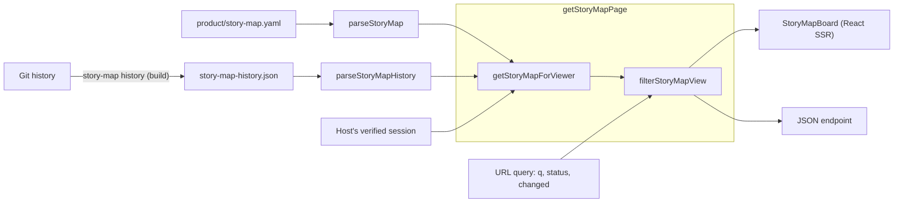

# Auto Story Map: engineering overview

Prepared 20 November 2026 for version 0.3.0, and updated for version 0.4.0: validator warnings, the merged, blocked and cut statuses, release notes and impact, stalled stories, and “last updated” from Git. Start here before changing the library. The [README](../README.md) and [the story map guide](story-map.md) describe how host products use it. This document explains how it works inside and which behaviour to preserve.

## What this library does

Auto Story Map lets a product show its own user story map at `/story-map`, behind the product's existing sign-in. Activities (the steps of the user journey) run left to right. Releases (delivery slices) run top to bottom. Each story sits in one activity and one release and has a status of `planned`, `in-progress`, `merged`, `shipped`, `blocked` or `cut`. The first four are the active statuses. Merged means the work is on the default branch but not yet available to its users, and customers see it as in progress. Blocked and cut stories are hidden by default and never shown to customers.

The map is a YAML file, `product/story-map.yaml`, committed in the host product's repository. It is edited through pull requests, like code, and ships with each deployment. Nothing is stored in a database, and the board is read-only.

The package has four parts:

- **A core library** that parses and validates the YAML, projects it for a viewer, and filters the projection.
- **A React board** that renders a projection as server-side HTML, with a detail panel for each story. The panels work without client-side JavaScript.
- **A CLI**, `story-map`, with `init`, `validate`, `diff`, `history` and `export` commands for setup, CI, PR summaries, Git-derived status history and Visio or CSV export.
- **Agent and editor support**: a guide and `AGENTS.md` section that `init` copies into the host, plus a JSON Schema for editor autocomplete.

Two audiences see the map. Internal viewers (by default the `engineer` and `super-admin` roles) see everything. Other signed-in users see a reduced customer-facing view, but only when the map has `visibility: all-users` and the story has approved customer copy. Guests see nothing.

## Runtime and architecture

| Layer | Implementation |
| --- | --- |
| Language | TypeScript 5.9, compiled by `tsc` to ES2022 ES modules in `dist/`. No bundler. |
| Runtime | Node.js 20 or newer. CI tests Node 20 and 26. |
| Dependencies | `yaml` (parsing with source positions) and `zod` 4 (validation and JSON Schema generation). |
| UI | React 18 or 19, an optional peer dependency. The board is a plain function component with no state or effects. |
| Styling | One namespaced stylesheet, `styles.css`, using `.esm-*` classes and `--esm-*` custom properties. |
| Git | The `diff` and `history` commands shell out to `git` with `execFile`, never through a shell. |
| Distribution | npm package `auto-story-map`, published from version tags with npm trusted publishing. |

The library never handles authentication, HTTP or storage itself. The host reads the YAML, resolves the viewer from its own verified session, and passes both in. Data flows one way:



`getStoryMapForViewer` is the security boundary. Everything after it only sees what the viewer is allowed to see. `getStoryMapPage` runs it and then the filters, so the safe order is the default. Hosts send `storyMapResponseHeaders` with every response.

### Package entry points

`package.json` `exports` defines the public surface. Anything not listed there is internal, even if it is in `dist/`.

| Import | File | Contents |
| --- | --- | --- |
| `auto-story-map` | `dist/index.js` | Parsing, validation errors, projection, filters, history parsing, diff |
| `auto-story-map/react` | `dist/react.js` | `StoryMapBoard` |
| `auto-story-map/styles.css` | `styles.css` | Board stylesheet |
| `auto-story-map/board.js` | `dist/board.js` | Optional browser script that applies filters as they change and remembers collapsed release lanes. Exported under `default`, so `require.resolve` finds it for hosts that copy it into their static files. |
| `auto-story-map/schema.json` | `story-map.schema.json` | JSON Schema for editors |
| `story-map` (bin) | `dist/cli.js` | CLI |

`buildStoryMapHistory` (`src/history-git.ts`), `loadStoryMap`, `checkSources`, `checkPlanReferences` and `initStoryMap` are not exported from the root entry point. Hosts reach them through the CLI. The demo imports `dist/history-git.js` directly, which is fine inside this repository but not a supported API.

The tests and the demo import the package by its own name (`import … from "auto-story-map"`). Node resolves this through the package's `exports`, so they exercise the built `dist/` output exactly as a host would. Run `npm run build` before running them; `npm test` and `npm run demo` do this for you.

## Code map

| Path | Responsibility |
| --- | --- |
| `src/status.ts` | The six statuses, the active and customer subsets, `customerStatus`, and their display labels. The single list every other module reads. |
| `src/schema.ts` | Zod schema for the YAML, cross-reference checks, warnings (`storyMapWarnings`), `parseStoryMap`, `loadStoryMap`, `StoryMapValidationError` and source-line lookup. Also `migrateStoryMap` and `loadHistoricalStoryMap`, the lenient parser for past versions |
| `src/view.ts` | `getStoryMapForViewer`: the internal and customer projections, role check, and attaching history to stories. `getStoryMapPage`, which projects then filters, and `storyMapResponseHeaders` |
| `src/filter.ts` | `readStoryMapFilters` (URL parameters) and `filterStoryMapView` (search, status and “changed in” filters) |
| `src/export.ts` | `prepareStoryMapExport`: the shared export model. Refuses customer and filtered views, marks collapsed lanes and keeps the most recently changed stories up to `maxStories` |
| `src/export-layout.ts` | Lays out the export as a board in inches, and estimates text wrapping to size lanes and shorten card titles |
| `src/export-vsdx.ts` | `storyMapToVsdx`: writes the layout as Visio XML parts and zips them |
| `src/export-csv.ts` | `storyMapToCsv`: writes a row per story, quoted following RFC 4180, with formula-looking fields defused |
| `src/export-response.ts` | `storyMapExportResponse`: reads a host route's `format` and `collapsed` parameters and returns the file with download headers |
| `src/zip.ts` | A stored (uncompressed) zip writer with CRC-32 and a fixed timestamp, so output is stable |
| `src/history.ts` | History file types and `parseStoryMapHistory` |
| `src/history-git.ts` | `buildStoryMapHistory`: walks the map's Git history and records additions and status changes |
| `src/diff.ts` | `diffStoryMaps` and `formatStoryMapDiff`: compares two map versions and renders the PR summary |
| `src/references.ts` | `--check-sources` (files and GitHub heading anchors) and `--plans` (story IDs in Markdown) |
| `src/init.ts` | `story-map init`: writes the starter map, guide, `AGENTS.md` section and CI workflow without overwriting |
| `src/cli.ts` | Argument parsing, output formats and exit codes for the five commands |
| `src/board.ts` | The optional browser script, `enhanceStoryMapFilters`. The only code that runs in the browser. |
| `src/react.tsx` | `StoryMapBoard`: grid, cards, popover panels, filter toolbar, history list and date formatting |
| `src/version.ts` | Generated by `scripts/write-version.mjs` from `package.json` at build time, and not committed: `storyMapVersion`, `storyMapRepositoryUrl`, `storyMapLicense` and `storyMapAuthor` |
| `src/index.ts` | Root entry point re-exports |
| `styles.css` | Board styles, light, dark and `auto` themes, and the narrow-screen layout |
| `templates/` | Files `init` copies into a host: starter `story-map.yaml`, `AGENTS.md` section and `story-map-ci.yml` |
| `docs/story-map.md` | The user guide. **It is also shipped in the package and copied into hosts by `init`.** |
| `docs/plans/` | Delivery plans. `0.4.0-enhancements.md` records what 0.4.0 built and the items still proposed. |
| `docs/releasing.md` | How to publish a version |
| `product/story-map.yaml` | This library's own story map, with `ESM-` story IDs: one release per version, the 0.4.0 work as `merged` until it is on npm, one cut story and the proposed next items. The demo shows it, and CI validates it with `--check-sources`, so its doc links must stay valid. Keep it up to date like any product's map. |
| `test/fixtures/builder-estimates.yaml` | The builder estimates sample map, including one cut story (`FINANCE-202`). It is test data with stable IDs that the tests and the guide's examples rely on. Tests that need FINANCE-202 still planned use the `planningMap` copy. |
| `example/host.mjs` | Reference host integration: one function that returns a web `Response` for the page, the JSON endpoint or the export download |
| `example/demo.mjs` | Local demo server on `127.0.0.1:4173` with a role switcher |
| `scripts/write-version.mjs` | Writes `src/version.ts` before `tsc` runs |
| `scripts/build-schema.mjs` | Generates `story-map.schema.json` from the compiled Zod schema |
| `scripts/export-sample-vsdx.mjs` | Exports the sample map as a `.vsdx` for the LibreOffice check in `export-check.yml` |
| `scripts/make-export-test-files.mjs` | The ESM-701 spike: writes the hand-made test files in `test/fixtures/export-spike/` |
| `scripts/smoke-package.sh` | Packs the tarball, installs it into an empty project and checks the imports, CLI and board |
| `test/story-map.test.mjs` | Example-based tests, using `node:test` |
| `test/references.property.test.js` | Property tests for the heading anchor scanners, using `fast-check` |
| `.github/workflows/` | `ci.yml` for PRs and `main`, `release.yml` for version tags, and `export-check.yml`, which checks LibreOffice opens the `.vsdx` on PRs that change export code |

## The map file

### Format

`src/schema.ts` is the source of truth for the format. The top level has `version: 1`, `id`, `title`, optional `summary`, `visibility` (`internal` by default, or `all-users`), optional `customer` copy, and the `activities`, `releases` and `stories` lists.

- The order of `activities` is the journey order. The order of `releases` is the delivery order. The order of `stories` is the order within each cell.
- IDs match `^[A-Za-z0-9][A-Za-z0-9_-]{0,63}$`. Story IDs such as `BUILDER-102` are stable: renaming or moving a story keeps its ID, and history, diffs and delivery plans all key on it.
- A story's `status` defaults to `planned`. `statusReason` (up to 500 characters) records why a story is blocked or cut.
- A release can have `notes` (plain text, up to 800 characters, blank lines between paragraphs) and up to 10 `impact` items, each with a required `metric` and `expected`, and optional `solves`, `actual` and `draft`. Activities do not take these fields. Impact items have no ID, so the diff matches them by `metric`.
- Optional `settings` hold map-wide options. The only one is `stalledAfterWeeks` (whole weeks, 0 to 104, default 4 from `defaultStalledAfterWeeks`, 0 turns the flag off).
- `sources` is a list of up to 20 strings. A string is either a URL, a repository-relative path (optionally with a `#heading`), or free text such as “Agreed in planning”.
- Every object is `.strict()`, so an unknown field is an error rather than being silently dropped. This catches typos such as `staus`. Past versions of the map are the exception: see [Reading past versions](#reading-past-versions).
- Size limits (titles 120 characters, summaries 500, notes 4,000, 50 activities or releases, 1,000 stories) keep a malformed or hostile file from producing an unusable page.

Cross-reference rules, checked in `crossReferenceIssues`:

- IDs are unique within each list.
- Each story's `activity` and `release` exist.
- An `all-users` map needs map-level `customer` copy.
- A story with `customer` copy needs customer copy on its activity and its release, so a customer never sees an internal label.

### Parsing and error reporting

`parseStoryMap(text)` returns a typed `StoryMapDocument` or throws `StoryMapValidationError`, whose `issues` each have a `severity`, `path`, `message`, `line`, `column` and the `itemId` of the containing activity, release or story.

Issues are errors or warnings. Errors make the map invalid and are thrown. Warnings are advice about a valid map: a blocked or cut story with no `statusReason`, a release with active stories but no `impact`, and an impact item still marked `draft: true` in a release with shipped stories. A release whose stories are all blocked or cut needs no impact. `storyMapWarnings(map)` computes them from the parsed document, and `loadStoryMap` returns them, located in the source, as `warnings`. `parseStoryMap` drops them. Never make a warning depend on something an error would catch: warnings only run once the map is valid.

How `loadStoryMap` gets there:

1. Parse with `yaml`'s `parseDocument` and a `LineCounter`, with `uniqueKeys: true` so duplicate keys are errors. YAML syntax errors are reported immediately.
2. Convert to plain data with `maxAliasCount: 20`, which stops alias-expansion (“billion laughs”) files.
3. Validate with Zod, with a custom error map for clearer “Missing required field.” and “Use one of …” messages.
4. If Zod fails, run `crossReferenceIssues` again on the raw data. Zod skips `superRefine` once any field fails, so without this step a file with one typo would hide its broken references until the next run. Issues are deduplicated against Zod's.
5. Map each issue path back to a YAML node to get its line and column. `unrecognized_keys` issues are split into one issue per key, located at the key itself.
6. Sort issues by line.

`loadStoryMap` also returns `warnings` and `locate(path)` so later checks, such as `--check-sources`, can report positions in the same file.

### Reading past versions

History and `story-map diff` read earlier versions of the map from Git, and those may use an earlier format. `loadHistoricalStoryMap` reads them leniently. It is not exported from the package index.

- The schemas come from one factory, `formatSchemas(strict)`, so there is a single description of the format. Strict mode rejects unknown fields. Lenient mode drops them.
- It uses the same YAML settings as `loadStoryMap`: unique keys and `maxAliasCount: 20`.
- Each story is parsed on its own. A story that still fails, such as one with a status that no longer exists, is dropped rather than failing the whole version.
- Cross-reference checks are skipped.
- It returns `{ map, dropped: { stories, storyIds, fields } }`. A YAML error, or a map whose other parts do not validate, still throws.

Both parsers run `migrateStoryMap` on the raw data before validating. It does nothing today. When a format change renames a field or a status, map the old form to the new one there.

### JSON Schema

`story-map.schema.json` is generated, not hand-written. `npm run build` runs `tsc` and then `scripts/build-schema.mjs`, which calls `z.toJSONSchema(storyMapSchema, { io: "input" })`. The `input` mode means fields with defaults, such as `status`, are optional for editors. Field descriptions come from the `.describe()` calls in `src/schema.ts`, so edit them there.

The generated file is committed because hosts reference it from `node_modules` and the starter map's `yaml-language-server` comment points at it. CI fails if the committed file differs from a fresh build. After any schema change, run `npm run build` and commit `story-map.schema.json`.

The JSON Schema cannot express the cross-reference rules. Editors catch shape errors; only the validator catches duplicate IDs and unknown references.

## Audience projection

`getStoryMapForViewer(map, viewer, { canViewInternal, history, stalledAfterWeeks, now })` in `src/view.ts` decides what a viewer may see and builds a new object containing only that. It returns `null` for no access.

| Viewer | Result |
| --- | --- |
| `null` (guest) | `null`. The host should answer 401. |
| `canViewInternal(viewer) === true` | Internal view: all activities, releases and stories, with IDs, notes, sources, `updatedBy`, history, and each release's notes, impact and `storyCounts` |
| Anyone else, `visibility: all-users` | Customer view |
| Anyone else, `visibility: internal` | `null`. The host should answer 403. |

The default `canViewInternal` checks for the `engineer` or `super-admin` role (`defaultInternalRoles`). Hosts can pass their own rule. Only a strict `true` grants access, so a rule that returns a truthy string or a promise does not accidentally open the internal map.

**Risk: the default rule trusts role names.** The library is set up mainly for internal use, so a host that passes no rule shows the internal map to any viewer with the `engineer` or `super-admin` role. That is deliberate, but those names are generic. In a product where customers can have a role called `engineer`, they would see engineering notes, block and cut reasons, and the names in the history. Hosts with roles like that must pass `canViewInternal` when they install the library. This was reviewed and kept on purpose in the [review fixes plan](plans/0.6.0-review-fixes.md#5-the-default-rule-for-who-sees-the-internal-map-out-of-scope) (ESM-604).

The customer view is built from scratch, not by deleting fields from the internal one:

- Only stories with `customer` copy and an active status are included, using the customer title and summary. Blocked and cut stories are dropped before activities and releases are chosen, so a release that only contains them disappears too.
- Only activities and releases that contain a published story and have customer copy are included.
- Real IDs are replaced with sequential ones (`story-1`, `activity-1`, `release-1`), so internal IDs and the number of hidden stories do not leak.
- Notes, sources, `statusReason`, `updatedBy`, history, and release notes, impact and story counts are never copied.
- The status goes through `customerStatus`, which shows `merged` as `in-progress` because customers cannot use the work yet. Other active statuses are shown as they are, so reviewers must still check that a customer-facing story's status is right for customers.

Both views have the same `StoryMapView` shape apart from `audience`, so the board and JSON endpoint treat them alike.

Internal releases are `InternalReleaseLabel`s. `storyCounts` counts the release's stories by status in the projection, before any filter, so the release panel's progress describes the whole release whatever the board shows.

When history is supplied, the internal view attaches each story's events newest first as `history`, and the newest event's time as `lastChangedAt`. It also records `history.generatedAt` and `history.complete` on the view so the board knows a history exists.

### Stalled stories

With history, the internal view also works out which in-progress stories are stalled. The threshold is the `stalledAfterWeeks` option if the host passes a number of 0 or more, otherwise the map's `settings.stalledAfterWeeks`, otherwise 4. A story gets `inProgressSince` only when it is in progress and its newest history entry moved it to in progress; any other newest entry means the history is older than the map, so the start date is unknown. It gets `stalled: true` when that start is more than the threshold before `now` (the option, defaulting to the current time). The view records the threshold as `stalledAfterWeeks` only when it has history and the flag is on, and the board and filter use that to decide whether to offer the **Stalled** filter. Stalled is a flag, never a status, and the customer view never carries any of these fields.

## Search and filters

`readStoryMapFilters(url.searchParams)` reads three parameters and ignores anything unknown:

- `q`: trimmed and cut to 100 characters
- `status`: one of the six statuses, `all`, or `stalled`
- `changed`: `1d`, `7d`, `14d` or `30d`

`filterStoryMapView(view, filters, { now })` returns a copy of the view with fewer stories and a `filter` object recording the active filters and the unfiltered total. The board shows its toolbar only when `filter` is present, so hosts that do not call it get a board without search.

`status` is a list of choices: statuses, plus `stalled`. A story is kept when its status is chosen, or when `stalled` is chosen and the story is stalled. In the URL it repeats, once per choice. `readStoryMapFilters` and `filterStoryMapView` drop unknown values and anything the view does not offer, keep board order, and read `all` as every status, so links from before it took several choices still work. Choosing exactly the default statuses is stored as no `status`, so the board looks and counts the same as with none. With no `status`, or none left after dropping, the filter keeps only active stories and records in `filter.hidden` how many blocked and cut stories matched the other filters but were hidden. The board shows that count with a link to `status=all`. The board's status filter is a `<details>` menu of checkboxes named `status`, ticked from `filter.status` or the default, with no “All” choice. A host that never calls `filterStoryMapView` gets no toolbar, so the board hides blocked and cut stories itself: it sets `data-hide-inactive` on the board, marks those cards `data-inactive`, and renders a **Show blocked and cut stories** checkbox. CSS `:has()` hides the cards, cells that only hold them, and the active-only lane counts until the box is ticked. Browsers without `:has()` ignore those rules and show every story with full counts, which fails safe for internal viewers. Customer views contain no blocked or cut stories, so for them the default changes nothing, and their status filter offers only the customer statuses: planned, in progress and shipped, all ticked by default.

Always filter after projecting. The search runs over the projected view, so a customer's search matches only approved titles and summaries, while an internal search also matches IDs and notes. Filtering the raw document first would let a search reveal hidden content through which results come back.

`stalled` adds stories with `stalled: true` to the other choices. On views without `stalledAfterWeeks` (customer views, no history, or the flag turned off) it is dropped, and if nothing else was chosen the default applies, so the URL never empties the board.

The “changed in” filter only applies to internal views that have history. It keeps stories whose `lastChangedAt` falls in the window, measured from `now`. Moving a story between activities or releases is not a change for this purpose; only additions and status changes are.

## The React board

`StoryMapBoard` in `src/react.tsx` is designed for server-side rendering with `renderToStaticMarkup`. It has no state, effects or event handlers, so it also works when hydrated, but nothing depends on client JavaScript.

### Layout

- The grid is a set of `div`s with ARIA `table`, `row`, `columnheader`, `rowheader` and `cell` roles. `--esm-columns` on the grid sets the number of activity columns for CSS grid.
- Stories are grouped by `release:activity` key. Stories whose activity or release is missing from the view are skipped (`placed`), which also guards against a host passing a hand-built view.
- While filtering, releases with no matching stories are hidden. Without filters, every release shows, even when empty, so engineers can see the full plan. The default Active status filter does not count as filtering for this, and neither does choosing every status.
- Release lanes cycle through three colour schemes using `data-lane` (index modulo 3).
- Each release header has a collapse toggle, top right of an open lane and between the title and story count of a collapsed one, (`ReleaseCollapse`): a `<label class="esm-collapse">` holding a visually hidden checkbox, `.esm-collapse-input`, whose `value` is the release ID and whose accessible name is “Collapse <release title>”. CSS `:has()` hides a checked lane's cells, summary and impact line, and stretches its header across the row, leaving the title, story count and chevron. The toggle is only shown inside `@supports selector(:has(*))`, so browsers without `:has()` never offer a toggle that would do nothing. Customer boards get the toggle too, with their renumbered release IDs as values. Collapsing hides cards but not their panels, so the release panel still opens stories in a collapsed lane.
- The eyebrow reads “User story map” for internal viewers and “Roadmap” for customers.
- The header (`.esm-header`) shows the map title and, under it, either the map's `summary` or, on internal views with history, a recent updates line (`RecentUpdates`, `.esm-recent`). `getStoryMapForViewer` builds `recentUpdates` before filtering, so it does not change with the filters: the latest edit to any story (its `lastEdit`, or its newest status event in older history files), who to credit, and the releases with stories changed in the `recentUpdateDays` (14) up to that edit, most changed first. The board names the top three and counts the rest.
- A footer (`.esm-footer`) under the frame shows “Auto Story Map <version>”, the author and the licence, so anyone can tell which version is running. Internal boards link the author to their profile and the licence to `LICENSE`, and add **Changelog** (the version's heading in `CHANGELOG.md` on `main`) and **Source code** links, all opening in a new tab. Customer boards show the same text without links. `showVersion={false}` removes the footer. The version, licence and author come from `src/version.ts`, which the build generates from `package.json` (`version`, `license`, and the `author` name and URL, never the email), so it cannot drift from the published version.

### Detail panels without JavaScript

Each card is a `<button>` with a `popovertarget` pointing at its panel. Each panel is a `<div popover="auto" role="dialog">` rendered after the grid. The browser's HTML popover API opens and closes it, handles Escape and light dismiss, and shows a `::backdrop`. The close button uses `popovertargetaction="hide"` and `autofocus`.

React 19 knows these attributes by their camelCase names, while React 18 only passes them through in lower case. `popoverTarget()` picks the right spelling from React's `version`. The smoke test renders the board with both React versions and checks that every card's target matches a panel ID, so keep that test passing when touching this code.

On internal boards, each release title is also a `<button>` that opens a release panel (`ReleaseDetail`, class `esm-detail esm-release-detail`). The panel lists the release's stories that are on the board, grouped by status, and each one is a button targeting that story's panel. Because that button sits inside the release panel, the browser treats the release panel as the story panel's popover ancestor: opening a story keeps the release panel open underneath, and closing it returns there. Release panels exist only for the releases shown, and only on internal boards. Customer boards render release titles as plain text.

A stalled card shows “In progress for 6 weeks” (`.esm-stalled`, with a warning icon and the start date as a tooltip) in place of its relative time. The story panel shows “In progress since …” for any in-progress story with a known start (`.esm-progress-since`), and stalled stories add a warning note (`.esm-stalled-note`). Weeks shown are whole weeks from the board's `now`.

The lane shows the first impact item in one line with “+N more”, and a **Draft** label on drafts. Progress reads “3 of 5 stories shipped, 1 merged, 1 cut”: cut stories are left out of the total because they have left the release.

Panel IDs come from `useId()`, so two boards on one page do not collide.

### Engineering links

`resolveSources` turns each source into a link or plain text:

- A source containing whitespace is free text.
- Otherwise it is resolved with `new URL(source, sourceBaseUrl)`. Only `http:` and `https:` results become links, so a `javascript:` source cannot produce a clickable link.
- The first link whose path ends in `.md` and has a `#fragment` becomes the **Engineering overview** button. The rest are listed as sources.
- Without `sourceBaseUrl`, repository-relative paths cannot be resolved and show as plain text. Absolute URLs still work.

Engineering links open in a new tab with `rel="noopener noreferrer"`, an icon and screen-reader text.

### Filter toolbar

The toolbar is a `GET` form with no `action`, so it submits to the current page. `preservedParams` become hidden inputs, so a host can keep its own query parameters (the demo keeps `as`). “Clear filters” links to just the preserved parameters. The **Changed** select appears only for internal views with history. Internal views get **Active** (the default) and **All, including blocked and cut** at the top of the status select; customer views get **All statuses** and `customerStoryStatuses` (planned, in progress and shipped). When `filter.hidden` is set, the results line says how many blocked and cut stories are hidden and links to the same filters with `status=all`.

The optional `board.js` script (`src/board.ts`) enhances the form without changing it. It marks the form `data-esm-auto`, which hides the `.esm-apply` button through CSS. It then submits the form with `requestSubmit()` when a select changes or Enter is pressed in the search box, and stores the field's name in `sessionStorage` so focus returns to it after the reload. Changing a select reloads the page, so the board renders an empty, visually hidden hint (`data-esm-filter-hint`) referenced by each select's `aria-describedby`, and the script fills it in to warn screen reader users before they choose. Without the script the hint stays empty, so nothing false is announced. It also remembers collapsed release lanes (`enhanceStoryMapReleases`): it stores the checked toggles' values in `localStorage` under `esm-collapsed:<page path>` and checks them again on load, so lanes stay collapsed when a filter reloads the page and on later visits. It also rewrites the `href` of each `a[data-esm-export]` link in the board, adding `collapsed=<IDs>` for that board's checked toggles to the original URL in `data-esm-export`. `enhanceStoryMapMenus` closes the board's menus (`details.esm-menu`: the status filter and Export) on Escape, returning focus to the button, and on a click outside them. It closes Export after a link is chosen. The status filter is a group of checkboxes, so ticking one does not reload the page: the script submits the form when the menu closes with a changed choice, and focus returns to the menu's button (`data-esm-focus="status"`) after the reload. Without the script, the toggles still work but reset on reload. Keep it a separate file: an inline script would need `dangerouslySetInnerHTML` and would break hosts with a strict Content Security Policy.

### Dates

`locale` (default `en-GB`), `timeZone` and `now` control date output. Cards show relative times (“5 hours ago”, “yesterday”), switching to a date after 30 days. Without `timeZone`, dates use the server's zone, which may not match the team's. Tests pass a fixed `now` so output is deterministic.

`dateFormatters` builds the `Intl` formatters once per render, not once per date. `Intl` throws a `RangeError` for a locale or time zone it does not recognise, which would fail the whole page, so the helper checks both first. A bad locale falls back to `en-GB` and a bad time zone to the runtime's zone, each with a `console.warn` that is logged once per process.

### Styling

All classes start with `esm-` and all colours are `--esm-*` custom properties on `.esm-board`, so hosts can restyle without overriding selectors. `data-theme` selects `light`, `dark` or `auto`.

The dark palette is written out twice in `styles.css`: under `[data-theme="dark"]` and under `[data-theme="auto"]` inside `@media (prefers-color-scheme: dark)`. The panel backdrop is set the same way. Change both copies together.

Below 650px wide, each release lane becomes a stacked section, the activity header row is visually hidden (it stays available to screen readers), each cell shows its activity name, and empty cells are hidden.

Class names and markup are part of the public contract. Hosts may have CSS that targets them, so changing them is a breaking change. 0.3.0 did this and documented an upgrade step.

## Status history

Status history shows when each story was added or changed status, who made the change and who merged it. It is derived from Git rather than recorded in the YAML, so editors never maintain it by hand.

### Building it

`story-map history --out build/story-map-history.json` runs `buildStoryMapHistory` (`src/history-git.ts`) at the host's build time:

1. Refuse a shallow clone unless `--allow-shallow` is passed. In a shallow clone, the oldest version found is used only as a baseline, so stories that already existed are not reported as added on that date. The output then has `complete: false`.
2. List commits that touched the map with `git log --first-parent --reverse` on the chosen ref, usually `main`. First-parent means each change is dated when it reached that branch, not when it was written on a feature branch.
3. Read each version with `git show <sha>:<path>` and parse it leniently with `loadHistoricalStoryMap`, so versions in an older format still count. A story dropped from a version keeps its previous state, so it is not recorded as removed and then added again. A version is skipped only when the map is missing or cannot be read at all. Skipped versions are listed in `skipped` (at most 100, as `{ commit, reason }`) and counted in `skippedCount`, both absent when there are none, and the next readable version is compared with the last readable one. The CLI prints a warning naming the first three and still exits 0.
4. Compare each version's stories with the previous one by ID. A new ID produces an `added` event. A changed `status` produces a `status` event with `from` and `to`. When the new status is blocked or cut and the story has a `statusReason`, the event records it as `reason`. Moves, renames and other edits produce no event, and removing a story produces no event.
5. Separately, any difference in a story's fields (compared with `canonical`, which ignores key order), including a move or a new story, updates that story's last edit. Reordering the stories list is not an edit. At the end, `lastEdits` keeps one entry for each story in the newest valid version.
6. Store `at` as the commit's committer date, normalised with `toISOString()`. Git versions print UTC as either `+00:00` or `Z`, and a canonical form keeps the file stable and comparable.

Who is credited:

- **`by`** (for events and last edits): the story's `updatedBy` if this change set or changed it. Otherwise the commit author, unless the author is a bot (a name ending in `[bot]`, or one of `botNames` from `--bot-names`, compared case-insensitively) and the commit has a `mergedBy` who is not a bot: then the merger. For a merge commit, it is the author of the latest non-merge commit on the merged branch that touched the map, found with one extra `git log` per merge, and cached for that commit.
- **`mergedBy`**: for a merge commit, its author (the person who merged). For a single-parent commit, the committer, unless the committer is `GitHub`. GitHub records itself as the committer of squash and rebase merges made on the website, so those entries have no `mergedBy`.

Git names have no length limit, but the history format does. Every `by`, `mergedBy` and `reason` goes through `fitHistoryText` in `src/history.ts`, which trims it and cuts it to `historyNameMaxLength` (120) or `historyReasonMaxLength` (500) code points, ending in “…”. The schema counts code points the same way, so the writer can never produce a file the reader rejects. The `StoryMapHistory` interfaces and `storyMapHistorySchema` both describe the format, and a compile-time check makes `tsc` fail if they disagree, so change them together.

### Using it

The host reads the JSON with `parseStoryMapHistory`, which validates it with Zod, and passes it to `getStoryMapForViewer` as `history`. `lastEdits` is optional in the schema, so history files from before 0.4.0 still load. The internal view attaches each story's entry as `lastEdit`, which the panel shows as “Last updated 3 days ago by …”. Without it, the panel falls back to `updatedBy`. `lastEdit` never changes `lastChangedAt` or the **Changed** filter. Only internal views receive it. The file contains people's names, so the guide tells hosts to keep it out of static asset directories.

A host without a history file loses nothing else: no dates on cards, no history in panels, no **Changed** filter and no stalled flag, and panels show `updatedBy` instead of the last edit.

## CLI

`src/cli.ts` parses arguments by hand to avoid a dependency. Options accept both `--name value` and `--name=value`. An unknown option or a missing value prints the usage and exits with code 2. With `--name value`, a next argument that starts with `-` is another option, not the value, so `--map --strict` is a missing value: the CLI prints `story-map: --map needs a value` before the usage. A value that starts with a hyphen can be passed as `--name=-value`.

| Command | What it does | Exit codes |
| --- | --- | --- |
| `validate [--format text\|github] [--strict] [--check-sources] [--plans <dir>]… [--root <dir>] <map>…` | Parses each map, then runs the optional reference checks | 0 valid (warnings allowed), 1 errors, or warnings with `--strict` |
| `diff [--format markdown\|json] [--map <path>] <base-ref>` | Compares the working copy of the map with its version at a Git ref | 0, 1 invalid map, 2 Git or usage error |
| `history [--map] [--ref] [--out] [--bot-names] [--allow-shallow]` | Writes the history JSON | 0, 1, 2 Git error or shallow clone |
| `init [--no-ci] [--dir <path>]` | Sets up a host repository | 0 |

### validate

Text output goes to stderr as `file:line:column: path (ITEM-ID): message`, with `warning: ` before the path for warnings. `--format github` prints `::error` or `::warning file=…,line=…,col=…::` workflow commands to stdout, escaping `%`, newlines, `:` and `,` as GitHub requires, so problems appear on the PR diff.

`--check-sources` (`checkSources` in `src/references.ts`) looks at each source that looks like a path: no whitespace, no URL scheme and no leading `//`. It reports files that do not exist and paths that resolve outside `--root`. It then resolves the path one component at a time from the real root (`resolveInRepository`), following symbolic links only while they stay inside, and reports a link out of the repository without reading it. It never looks at the link's target, so the result does not reveal whether a file outside the repository exists. A plain `realpath` would: a link to a missing file fails differently from a link to a file that exists. For Markdown files with a fragment, it checks the fragment against `markdownAnchors`, which reimplements GitHub's anchor rules: strip inline Markdown and HTML, lower-case, drop punctuation, turn spaces into hyphens, add `-1`, `-2` suffixes for duplicate headings, skip fenced code blocks, and accept Setext headings and `<a id>`/`<a name>` anchors. If GitHub's rendering and this function disagree, the validator either accepts a broken link or rejects a working one, so test any change against real GitHub output.

`--plans <dir>` (`checkPlanReferences`) scans Markdown under the folder for story IDs. The folder and every symbolic link found under it go through the same check, and a link out of the repository is reported, not read. It only checks IDs whose prefix the map already uses (`BUILDER-` in `BUILDER-102`), so ordinary text such as `UTF-8` is not flagged. This repository runs it over `docs/`, so any `ESM-` ID mentioned there must exist in the product map. `BUILDER-` and `FINANCE-` IDs in the docs refer to the sample fixture and are not checked.

### diff

`diff` reads the base version with `git show <ref>:<path>`. If the file did not exist at that ref, the map is reported as new. The base is read leniently with `loadHistoricalStoryMap`, because a PR that changes the format would otherwise fail CI until it merges. When anything was dropped, the Markdown summary starts with a `[!NOTE]` saying what, the JSON adds `baseDropped`, and the exit code stays 0. If the base cannot be read even leniently, the command fails rather than guessing. The current map is always checked strictly.

`diffStoryMaps(before, after)` matches stories, activities and releases by ID, so a rename is a rename rather than a removal and an addition. It reports:

- **Customer-facing changes** first: stories that become visible or stop being visible to signed-in customers, and visible stories whose customer title, summary, customer-facing status (through `customerStatus`, so in progress → merged is not a change) or customer-facing activity or release changes. A story counts as visible only when the map is `all-users`, has map customer copy and the story has customer copy.
- Visibility switches, as a GitHub `[!IMPORTANT]` or `[!NOTE]` alert.
- A **Blocked and cut** section (`blockedOrCut`): stories that became blocked or cut, with their reasons, and stories that returned to an active status. A blocked or cut story does not count as customer-visible, so a published story that becomes blocked or cut also appears under “No longer visible”.
- Added, moved, renamed, re-statused, edited and removed stories, in one table.
- A **Release notes and impact** section (`releaseDetails`): notes added, changed or removed, and impact items added, changed, confirmed (`draft` removed) or removed, with any `actual` result recorded called out. New releases are included, so a new map lists every release's impact.
- Added, renamed, removed and reordered activities and releases, and changes to their customer labels.
- A **Settings** section (`stalledAfterWeeks`) when the effective stalled threshold changes, counting a missing setting as the default of 4.

`formatStoryMapDiff` escapes all text taken from the map (HTML, Markdown punctuation, `|` and newlines), because the summary is written into PR job summaries and table cells. A story title must not be able to inject Markdown or break the table. Each `@` and `#` is followed by an empty `<span></span>`, because the summary is pasted into PR descriptions: a title such as “Ask @finance-team” must not notify that team, and `#123` must not link an unrelated issue. The span renders as nothing. Checked on a real PR: character references such as `&#64;` do not work, because GitHub decodes them before it finds mentions and references, and an empty HTML comment works in list items but is dropped inside table cells. Check any change here against GitHub's rendering of both.

### init

`initStoryMap` writes files with the `wx` flag, so it can never overwrite an existing file. Re-running it is safe:

- `product/story-map.yaml` from `templates/story-map.yaml`, with `__ID__` and `__TITLE__` filled from the host's `package.json` name (without its scope) or folder name.
- `docs/story-map.md`, copied from this package's `docs/story-map.md`. If the host already has a different copy, it is left alone and the output says to compare it.
- `AGENTS.md`: created, or the section from `templates/AGENTS.md` appended. The `<!-- auto-story-map:start -->` marker prevents appending twice.
- `.github/workflows/story-map.yml`, only when the host has a `package-lock.json`, because the workflow uses `npm ci`. Skipped with `--no-ci`.

Templates and the guide are found relative to the compiled `dist/init.js` (`new URL("../", import.meta.url)`). They must stay in the package `files` list.

## Security boundaries to preserve

- **Project, then filter, then render.** Never pass the parsed document to the board or a JSON response, and never filter before projecting. `getStoryMapPage` does both in the right order. Keep it a thin wrapper, and keep `getStoryMapForViewer` and `filterStoryMapView` exported for hosts that need the steps separately.
- **Build the customer view from an allow-list.** When adding a field to stories, decide explicitly whether customers see it. The default must be no. The tests check that customer HTML and JSON contain none of the internal content.
- **`canViewInternal` must return `true`.** Keep the strict comparison.
- **Keep internal IDs out of the customer view.** Customer IDs are renumbered on purpose.
- **Blocked and cut stay internal.** The customer projection drops them, and tests check that customer HTML and JSON never mention them or their reasons.
- **History contains names.** Keep it internal-only and out of static assets.
- **Responses are private.** `storyMapResponseHeaders` is `Cache-Control: private, no-store` and `X-Content-Type-Options: nosniff`. The example host sends it with every response, and hosts are told to do the same, because the page differs per viewer.
- **Only `http` and `https` sources become links.** React escapes all text, and the board never uses `dangerouslySetInnerHTML`. A test checks that story text renders as text.
- **The publish job installs nothing.** It is the only job that can get an npm publishing token, so it publishes the tarball built by `pack` and never runs `npm ci` or dependency scripts.
- **Git arguments are not shell input.** `git` runs through `execFile` with an argument array, and refs starting with `-` are rejected so they cannot be read as options.
- **Source checks stay inside the repository.** Paths that resolve outside `--root`, directly or through a symbolic link, are reported, not read, for sources and `--plans` alike. Never `stat` or read a link's target before checking it is inside.
- **Diff summaries notify nobody.** Text from the map has `@` and `#` escaped, so pasting the summary does not mention people or link issues.
- **Exports are internal only.** `prepareStoryMapExport` refuses customer views, so every export format inherits the rule. Keep that check in the shared model, not in each writer or host route. The board's export links are also internal only, whatever `exportHref` says.
- **Download file names come from a slug.** `storyMapExportResponse` reduces the file name to letters, digits, dots, hyphens and underscores before it goes in `Content-Disposition`, so a map title or host value cannot add headers.
- **Bounded input.** Keep the schema's length and count limits and the YAML alias limit.
- **The demo is not an auth model.** `example/demo.mjs` picks a role from `?as=` and listens only on `127.0.0.1`. Real hosts must take roles from their verified session.

## Local setup

Use Node.js 20 or newer.

```sh
npm ci
npm test
npm run validate
npm run demo
```

`npm ci` runs `prepare`, which writes `src/version.ts`, builds `dist/` and regenerates the schema. `npm test` rebuilds and runs `node --test`. `npm run validate` validates the product map with `--check-sources --plans docs`. It reports three warnings for drafted impact on shipped releases until a person confirms those items.

`npm run demo` starts [the demo](http://127.0.0.1:4173/story-map), showing this library's own map as **Super admin** by default. Set `STORY_MAP_DEMO_PORT` to use another port. The demo:

- reads `product/story-map.yaml` on every request, so YAML edits show up on refresh,
- serves `dist/board.js` at `/story-map-board.js`, which `example/host.mjs` loads, so filters apply as they change,
- builds history from this repository's Git history at startup, allowing a shallow clone, and logs a warning if Git is unavailable,
- starts as Super admin, and offers Regular user, Product manager, Engineer, Super admin and Guest views. It passes a custom `canViewInternal` that also admits `product-manager`, to show that option in use,
- links sources to this repository on GitHub with `sourceBaseUrl`.

`dist/` is ignored by Git. If an import fails or behaviour does not match the source, rebuild.

## Tests and CI

Tests use `node:test` with `node:assert/strict`. The example-based tests are in `test/story-map.test.mjs`. They cover:

- parsing defaults, duplicate keys and IDs, dangling references, customer-label rules, and error lines and item IDs,
- audience rules on the HTML page and JSON endpoint through `example/host.mjs`, including that customer output contains no internal content,
- card faces, popover panels, engineering links, sources after a JSON round trip, themes and escaping,
- the version footer, its internal-only links and that the changelog has a heading for the current version,
- collapse toggles on every release lane, with renumbered IDs on customer boards,
- filters, including that searches only see the projected view, the default that hides blocked and cut stories, and the checkbox on boards without filters,
- that customers never see blocked or cut stories,
- validator warnings, `--strict` and `::warning` annotations,
- `board.js` with a minimal fake DOM: selects and Enter in search submit, focus is restored after the reload, and enhancing twice adds no extra listeners, and collapsed release lanes are remembered across reloads,
- the CLI's text and GitHub output, `diff` against a Git ref, `init` in a temporary directory, source and plan checks, and GitHub anchor rules,
- that the committed JSON Schema matches the validator,
- history built from real temporary Git repositories, with merge commits, `updatedBy` credit, shallow clones, blocked or cut reasons, last edits to any field, bot authors credited to mergers, and history and last edits on the board,
- stalled stories: the threshold from the map, the host override and 0, measuring from the latest start, no flag without history or with an out-of-date history, the filter, the board and the customer view.

Tests that need Git create temporary repositories and clean them up. They need `git` on the path.

`test/references.property.test.js` uses `fast-check` to generate Markdown full of the characters the heading scanners treat specially. It checks that `slugify` and `markdownAnchors` give the same anchors as the regexes the scanners replaced (ESM-610), kept in the test as the reference, and that repeated headings get GitHub's `-1`, `-2` suffixes. Each property runs 1,000 cases. When you change `src/references.ts`, run a longer pass with `FC_NUM_RUNS=300000 node --test test/references.property.test.js`. That takes about 7 seconds. A failure prints the seed and path to replay it. The file is `.js`, not `.mjs`, so that OpenSSF Scorecard's fuzzing check finds the `fast-check` import.

`ci.yml` runs on every PR and push to `main`, on a matrix of Node 20 and 26 with React 18 and 19:

1. `npm ci --ignore-scripts`, then `npm run build`, so no dependency's install script runs in CI
2. Validate the product map with `--format github --check-sources --plans docs`
3. On PRs, once per run, append `story-map diff origin/<base>` to the job summary. The checkout uses `fetch-depth: 0` for this.
4. `npm test`
5. Fail if `story-map.schema.json` differs from the freshly built schema
6. `scripts/smoke-package.sh`: pack the package, install it with the matrix React version into an empty project, run `validate` and `init`, render the board, check popover wiring, and resolve the stylesheet and schema through the package exports

The smoke test is the only check of what actually ships. A file that works in the repository but is missing from `files` in `package.json` fails here.

Actions are pinned to commit SHAs with the version in a comment. `templates/story-map-ci.yml` uses the same pins; update both together.

## Releasing

[The release steps](releasing.md) are the full procedure. In short: bump `package.json` with `npm version <version> --no-git-tag-version`, add a `## <version>` section to `CHANGELOG.md`, merge, then push a `v<version>` tag.

`release.yml` reruns the full CI matrix, then a `pack` job with read-only permissions builds and packs the package and uploads the tarball. The `publish` job downloads it, checks the tag matches `package.json`, the tarball's version and a changelog section, publishes the tarball with `npm publish --provenance` using npm trusted publishing (OpenID Connect, no stored token), and creates a GitHub release from the changelog section. It runs in the `npm` GitHub environment, where maintainers can require approval. If the version is already on npm, it only creates the GitHub release.

The `publish` job installs nothing. It can mint an npm publishing token, so a dependency's install script running there could publish a malicious version with valid provenance. Keep build and test steps in `check` or `pack`, which install with `npm ci --ignore-scripts` and build explicitly.

Before 1.0.0, a minor version may contain breaking changes. Each one needs a changelog entry marked **Breaking**, an upgrade section in `docs/story-map.md`, and updated upgrade links in `README.md` and `AGENTS.md`.

## Branches and pull requests

Give every branch a meaningful name, so anyone can tell from the name alone what it holds: a type such as `fix/`, `feat/`, `docs/`, `chore/` or `release/`, then a few words describing the work, with the story IDs when it has them. For example, `fix/esm-601-history-name-length`, `fix/esm-606-607-cli-and-diff-escaping`, `docs/review-fixes-plan` or `release/0.6.0`. Never use random or generated names, such as `claude/zealous-fermat-srf6a2`.

Branches follow the work, not the map, so there is no rule of one branch or pull request per story. Small, related stories that change the same area can share a branch and a pull request, as ESM-606 and ESM-607 did. A large story can be split across several. Keep each pull request to one change that can be reviewed and reverted on its own, update the map for every story it touches, and name those stories in its description.

## Making common changes

### Add a field to the map

1. Add it to the Zod schema in `src/schema.ts` with a `.describe()` text. Use `.optional()` so existing maps stay valid.
2. Decide whether it belongs in the internal view, the customer view or neither, and update `src/view.ts`. Add it to `InternalStoryCard` or `StoryCard` as needed.
3. If it is user-editable content, add it to the edited-field list in `diffStoryMaps`. For customer-visible fields, also add it to the customer-facing comparison.
4. Render it in `src/react.tsx` if needed, and decide whether search should match it in `src/filter.ts`.
5. Run `npm run build` and commit the regenerated `story-map.schema.json`.
6. Document it in `docs/story-map.md`, add tests, and add a changelog entry.

Adding an optional field is the only change that needs nothing else. Any change that is not purely additive, such as removing or renaming a field or a status, needs a mapping in `migrateStoryMap` and a history test that builds a repository with commits in the old format, so past versions keep their events and dates.

### Add or change a status

`storyStatuses` in `src/status.ts` drives the schema, history schema, filters, toolbar and diff. `activeStoryStatuses` decides what the board shows by default and which stories customers can see. `customerStatus` and `customerStoryStatuses` decide which status customers see for them; a new active status that customers should not see by name needs a mapping there. The board's `StatusIcon`, the `[data-status]` colours in `styles.css` (in all three palettes) and the guide need matching entries. Never rely on colour alone: each status has an icon and a text label. Old history files with the previous statuses must still parse. Removing or renaming a status also needs a mapping in `migrateStoryMap`, or past versions lose the stories that use it (see [Add a field to the map](#add-a-field-to-the-map)).

### Change the guide or agent instructions

`docs/story-map.md` serves three roles: this repository's documentation, the file shipped in the package, and the file `init` copies into hosts. Hosts that already have a copy do not receive updates, so behavioural changes also need a changelog note and, if breaking, an upgrade step.

Keep the guide's headings stable. The README, `AGENTS.md`, `templates/AGENTS.md` and hosts' own docs link to anchors such as `#populate-the-first-map` and `#upgrade-to-030`.

The root `AGENTS.md` instructs agents working in this repository. `templates/AGENTS.md` is what hosts receive. They are similar but separate, so update both when the guidance changes.

### Change board markup or class names

Treat it as a breaking change for hosts with custom CSS. Update the smoke test's markup assertions if needed, check both React versions, and check the narrow-screen layout and both dark-theme blocks.

## Known limitations

- The board is read-only. All edits go through PRs on the YAML file. Editing in the app would need the map stored on a separate hosted service.
- Each product has one map file. There is no merging of several maps.
- History needs a full clone at build time. Squash and rebase merges on GitHub do not record who merged. Removing a story, or moving it between activities or releases, records no event.
- The customer view shows the story's internal status unchanged. There is no separate customer status. Blocked and cut stories are left out instead.
- `--check-sources` does not check absolute URLs or free-text sources. `--plans` only recognises `PREFIX-number` IDs.
- `init` only writes the CI workflow for npm projects.
- Every story's panel is rendered into the page, so its size grows with the map: about 3 KB per story for internal viewers before compression. The guide's [Large maps](story-map.md#large-maps) section has measured sizes. Loading panels on demand would need client JavaScript.
- Panels depend on the HTML popover API, which all current major browsers support. There is no fallback for older browsers.
- Dates use the server's time zone unless the host passes `timeZone`.
- Stalled stories need a history file. Hosts without one get no flag.

The [0.4.0 plan](plans/0.4.0-enhancements.md) records the 0.4.0 work. Validator warnings, the merged, blocked and cut statuses, release notes and impact, flagging stalled stories, and “last updated” from Git shipped in 0.4.0. Release notes and impact are written in PRs, never on the board. Still proposed: expandable steps within activities, and a scheduled agent that audits the map against the code.

## Documentation precedence

1. The source in `src/` and the tests. Where documents disagree with them, the code is right; fix the document.
2. This overview, for architecture and the rules to preserve.
3. [The story map guide](story-map.md), for host-facing behaviour and editing rules.
4. [The changelog](../CHANGELOG.md), for what changed in each version and its upgrade steps.
5. [The release steps](releasing.md) and [plans](plans/), for process and proposed work.

The [README](../README.md) is the entry point for people evaluating or installing the library.
